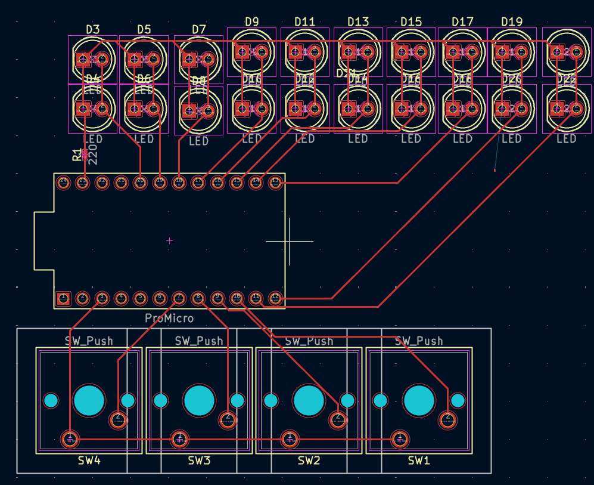
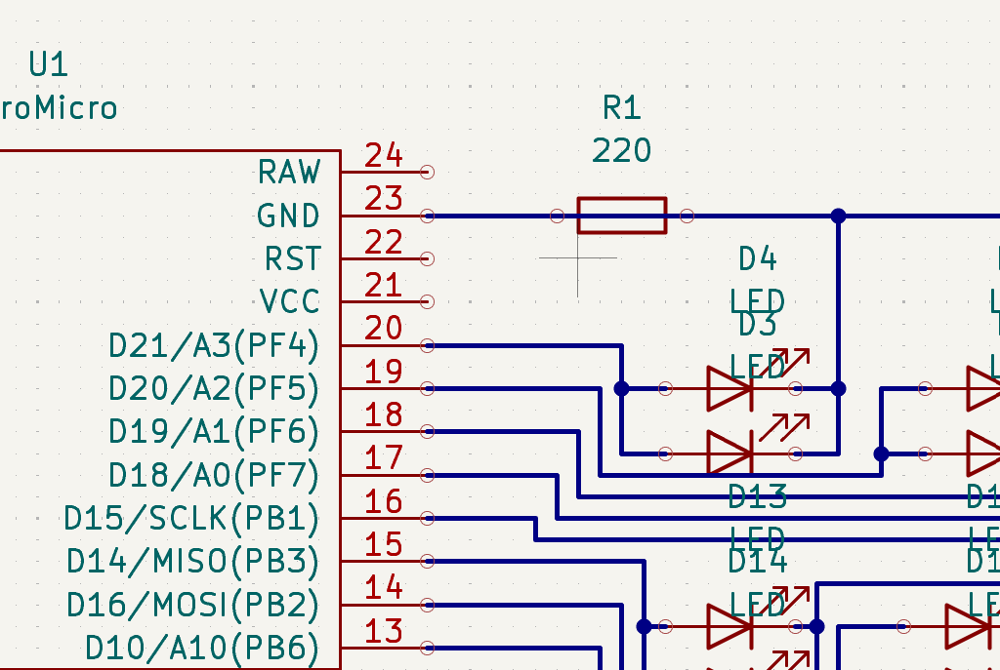

# Master-Dice-Roller
Week 5 of Hack Club Half-Life

# PCB

My PCB should allow me to dispay up to 20 lights at once to communicate a result. I have avoided binary to make the results easier and more convenient to read. I was going to use binary inspired LED organisation and put 1, 2, 4, 8, and 16 LEDs on a single pin to allow for more buttons, but that could blow the Arduino Pro Micro, so I am limited to 4 buttons, which i will probably assign d4, d6, d8, d20, and just change when necessary.#

# Schematic

Here is how the PCB will work.

# Bill Of Materials

