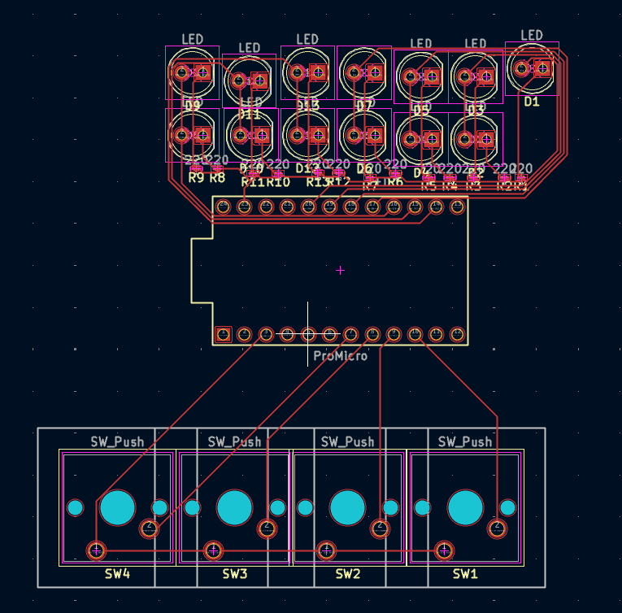

# Master-Dice-Roller
Week 5 of Hack Club Half-Life

# PCB

My circuit should allow me to display up to 20 lights at once to communicate a result. I have avoided binary to make the results easier and more convenient to read. I was going to use binary inspired LED organisation and put 1, 2, 4, 8, and 16 LEDs on a single pin to allow for more buttons, but that could blow the Arduino Pro Micro, so I am limited to 4 buttons, which i will probably assign d4, d6, d8, d20, and just change when necessary.#

# Schematic

Here is how the PCB will work.

# Bill Of Materials

| Component | Quantity | Cost ($) |
|---|---:|---:|
| 220 Ohm Resistors | 1 pack of 50 | 1.43 |
| Buttons | 1 pack | 6.00|
| Breadboard Kit | 1 | 12.42 |

The rest (LEDs, Pro Micro, Breadboard) I can reuse from previous projects to minimize costs. 
